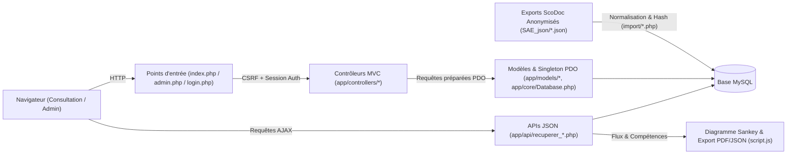

<div align="right">
  <a href="./README.md"></a>
  <a href="./README.fr.md"></a>
</div>

# Mnémosyne

Plateforme web d'analyse de cohortes étudiantes développée sur un an pour l'IUT de Villetaneuse : normalisation d'exports ScoDoc anonymisés, visualisation des parcours via diagrammes de Sankey interactifs et génération de bilans PDF/JSON.

## Contexte & Problème

Le suivi des promotions BUT sur 3 ans implique de croiser des exports JSON hétérogènes répartis sur 6 formations (`INFO`, `GEA`, `GEII`, `RT`, `CJ`, `SD`), avec des libellés variables, des passages conditionnels avec dette et des bascules entre formation initiale (`FI`) et apprentissage (`FA`).

Mnémosyne unifie ces exports dans une base MySQL normalisée et remplace le traitement manuel sur tableur par une visualisation interactive des transitions annuelles et de la validation des compétences.

## Architecture Technique



## Choix d'Ingénierie, Sécurité & Performance

- **Architecture MVC PHP modulaire (`app/core/`, `app/controllers/`, `app/models/`)** : séparation nette entre routage, accès PDO centralisé (`Database` singleton) et vues HTML/JS sans surcharge de dépendances lourdes.
- **Sécurité applicative et base de données** : requêtes PDO préparées systématiques contre les injections SQL, jetons CSRF uniques sur les formulaires, régénération d'ID de session PHP, mots de passe hashés en `bcrypt` et identifiants isolés dans `env.php` (exclu via `.gitignore`).
- **Anonymisation dès l'ingestion** : les fichiers `SAE_json/` exposent uniquement des empreintes SHA-256 (`etudid`, `code_nip`) sans nom ni INE en clair.
- **Pipeline de normalisation ScoDoc (`import/`)** : corrige automatiquement les variantes de noms de parcours et détecte FI/FA (`import_formations.php`, `import_decision_annuelle.php`, `import_resultat_competence.php`) pour garantir des flux BUT1 -> BUT2 -> BUT3 -> Diplômé cohérents.

## Démarrage Rapide

### Prérequis

- PHP 7.4+ (testé sur PHP 8.2) avec extensions `pdo_mysql`, `json` et `zip`
- MySQL 5.7+ ou MariaDB
- Serveur web Apache/Nginx ou serveur interne PHP

### Installation locale

```bash
git clone https://github.com/Git-MohamedB/mnemosyne.git
cd mnemosyne

# Créer le fichier de configuration BDD (ignoré par git)
cp env.example.php env.php
```

Importer le schéma SQL :

```bash
mysql -u <user> -p <database> < mnemosyne-projet_bdd.sql
```

Lancer l'import des cohortes puis le serveur local :

```bash
php import/run_all_imports.php
php -S localhost:8080
```

Ouvrir `http://localhost:8080` (`tests/test_structure.php` contrôle la structure MVC et la connexion PDO une fois MySQL configuré).

## Pistes d'Amélioration

- Fournir un `docker-compose.yml` prêt à l'emploi (PHP + MySQL) pour lancer l'environnement complet en une commande.
- Adopter Composer (autoloading PSR-4) et enrichir la CI avec des tests PHPUnit sur base mockée en plus du `php -l`.
- Ajouter une gestion de permissions par département pour déléguer l'administration à chaque chef de filière.
