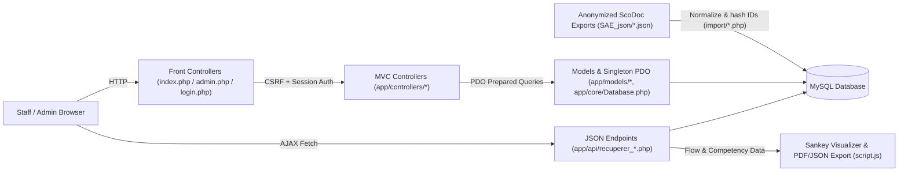

<div align="right">
  <a href="./README.md"></a>
  <a href="./README.fr.md"></a>
</div>

# Mnémosyne

Full-stack academic cohort analytics platform built over one year for IUT de Villetaneuse to normalize anonymized ScoDoc exports, track multi-year student progression via interactive Sankey diagrams, and generate PDF/JSON administration reports.

## Context & Problem

University departments tracking 3-year Bachelor (BUT) cohorts face fragmented JSON jury exports across 6 different programs (`INFO`, `GEA`, `GEII`, `RT`, `CJ`, `SD`) with inconsistent naming conventions, repeating debt levels, and work-study (`FA`) vs classic (`FI`) track switches.

Mnémosyne unifies ScoDoc ingestion into a normalized MySQL relational schema and replaces manual spreadsheet aggregation with interactive transition flows and skill validation metrics.

## Technical Architecture



## Engineering Choices, Security & Performance

- **Zero-framework PHP MVC (`app/core/`, `app/controllers/`, `app/models/`)**: Keeps routing, database access (`Database` PDO singleton), and views cleanly separated with strict server-side control and zero runtime dependency bloat.
- **Database & web security baseline**: All SQL queries use PDO prepared statements (`ATTR_ERRMODE => ERRMODE_EXCEPTION`), forms validate unique CSRF tokens, admin sessions regenerate session IDs and hash passwords with `bcrypt`, and DB credentials live exclusively in git-ignored `env.php`.
- **Privacy by design**: Student records ingested from `SAE_json/` store SHA-256 pseudonymous hashes (`etudid`, `code_nip`) with personal identifiers stripped prior to import.
- **Data normalization pipeline (`import/`)**: Handles program name variations across cohorts (`import_formations.php`, `import_decision_annuelle.php`, `import_resultat_competence.php`) to ensure consistent BUT1 -> BUT2 -> BUT3 -> Graduate Sankey edges.

## Quick Start

### Prerequisites

- PHP 7.4+ (tested on PHP 8.2) with `pdo_mysql`, `json`, and `zip` extensions
- MySQL 5.7+ or MariaDB
- Apache/Nginx or PHP built-in server

### Setup & Run Locally

```bash
git clone https://github.com/Git-MohamedB/mnemosyne.git
cd mnemosyne

# Configure database credentials (ignored by git)
cp env.example.php env.php
```

Import the schema and seed data:

```bash
mysql -u <user> -p <database> < mnemosyne-projet_bdd.sql
```

Run the cohort JSON normalization scripts and start a local PHP server:

```bash
php import/run_all_imports.php
php -S localhost:8080
```

Open `http://localhost:8080` in your browser (`tests/test_structure.php` verifies MVC file layout and PDO integrity when DB is running).

## Future Improvements

- Containerize the full PHP + MySQL + PhpMyAdmin stack via `docker-compose.yml` for zero-setup onboarding.
- Introduce Composer PSR-4 autoloading and PHPUnit suites with a mocked PDO connection in CI alongside `php -l` syntax checks.
- Add role-based read scopes per department head for multi-tenant administration.
